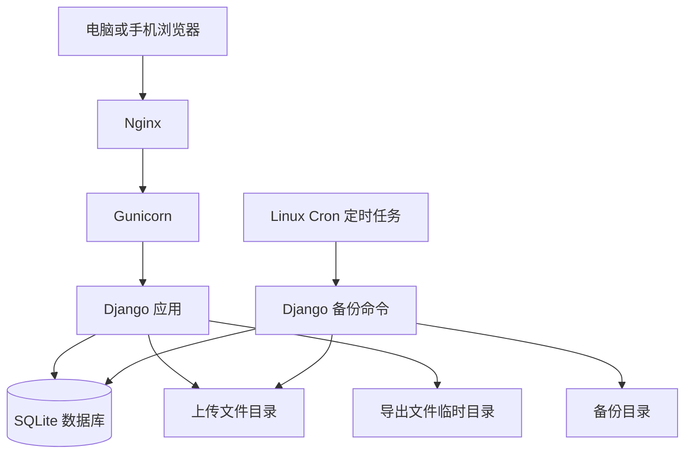

# 个人自用班级教学管理平台——详细实现方案

> 适用范围：单个班级、约 50 名学生、仅班主任本人使用  
> 目标服务器：阿里云试用 ECS，2 核 2 GiB，Ubuntu 22.04 64 位  
> 建议开发方式：本地使用 WorkBuddy 接入 DeepSeek API 辅助开发，代码经 Git/GitHub 管理后部署到服务器  
> 文档日期：2026-07-30

---

## 0. 先回答：用 WorkBuddy 接入 DeepSeek API 开发，再上传服务器部署，是否可行

**可行，而且适合这个项目。**

WorkBuddy/CodeBuddy 支持通过本地模型配置接入 DeepSeek 的 OpenAI 兼容 Chat Completions API，可以让 AI 在本地项目目录中辅助分析需求、建立文件、编写代码、修改代码和排查错误。因此，可以采用以下完整流程：

```text
本地 Windows 电脑
    ↓
WorkBuddy + DeepSeek API
    ↓
在本地项目目录生成和修改代码
    ↓
本地运行、测试、检查数据库和页面
    ↓
提交到私有 GitHub 仓库
    ↓
阿里云服务器 git pull
    ↓
Docker Compose 构建并启动
```

### 0.1 推荐结论

本项目不建议采用以下方式：

- 直接让 WorkBuddy 登录服务器并在生产目录里边写边改；
- 直接把 AI 第一次生成的完整项目上传服务器；
- 不经过 Git 就用压缩包反复覆盖服务器文件；
- 把真实学生姓名、电话、家庭地址、成绩等数据发送给模型；
- 把 DeepSeek API Key、Django 密钥和服务器密码写进代码仓库。

推荐采用：

> **WorkBuddy + DeepSeek API 负责辅助编码，本地环境负责验证，GitHub 私有仓库负责版本管理，服务器只负责运行稳定版本。**

### 0.2 WorkBuddy 与其他开发方式的比较

| 开发方式 | 是否适合 | 说明 |
|---|---:|---|
| WorkBuddy + DeepSeek API | 推荐 | 操作直观，适合通过自然语言拆分任务、生成文件和迭代修改 |
| CodeBuddy + DeepSeek API | 推荐，可作为备用 | 更偏代码工程，适合需要频繁浏览目录、运行命令和定位代码时使用 |
| VS Code + Claude Code/OpenCode + DeepSeek | 也很适合 | 工程控制更强，但命令行操作更多 |
| 直接让普通聊天网页生成整套代码 | 不推荐 | 缺少项目目录上下文，跨文件修改和持续调试较困难 |
| 直接在服务器上开发 | 不推荐 | 容易误删数据、造成服务中断，回滚困难 |

本方案仍按照你提出的 **WorkBuddy 接入 DeepSeek API** 来设计；当 WorkBuddy 对复杂代码定位不够稳定时，可以用 VS Code 打开同一个项目目录进行人工检查，不需要更换整个开发方案。

### 0.3 使用 WorkBuddy 时必须遵守的开发规则

1. 每次只让 AI 完成一个明确模块，不一次性生成全项目。
2. 每次修改前先让 AI 阅读已有文件和项目约定。
3. 每完成一个功能就本地运行测试。
4. 每个稳定节点都提交一次 Git。
5. 测试数据使用虚构姓名、虚构手机号和虚构成绩。
6. `.env`、数据库文件、备份文件、真实导入表格禁止上传 GitHub。
7. AI 生成数据库迁移后必须先检查，再执行迁移。
8. 涉及删除、批量覆盖和恢复数据的功能必须人工验证。
9. 服务器生产数据库不得交给 AI 随意修改。
10. DeepSeek API 仅用于开发辅助，不作为平台运行所必需的服务。

---

# 1. 项目定位

## 1.1 建设目标

建设一个仅由班主任本人登录和使用的班级教学管理平台，用于集中管理：

- 一个班约 50 名学生的基本信息；
- 座位安排和值日安排；
- 宿舍卫生与宿舍纪律；
- 课堂纪律、违纪、奖励与奖惩积分；
- 考勤和作业完成情况；
- 历次考试成绩及成绩分析；
- 学生评语、谈话记录和成长记录；
- 班委、学习小组、课程表和班级活动；
- 单模块数据导出、全量数据导出和定时自动备份。

## 1.2 使用角色

平台首版只设置一个角色：

```text
系统管理员 / 班主任
```

该角色拥有全部查看、增加、编辑、删除、导入、导出、备份和恢复权限。

不设置：

- 学生账号；
- 家长账号；
- 任课教师账号；
- 学生或家长查询端；
- 公开展示页面。

## 1.3 本次修改后的范围调整

本方案已经落实以下修改：

1. 删除花名册中的“学生状态管理”；
2. 删除“学法指导”整个模块；
3. 在日常管理中新增“宿舍管理”：
   - 宿舍基础信息；
   - 宿舍卫生；
   - 宿舍纪律；
   - 宿舍纪律条目可手工新增、编辑、停用和排序；
4. 课堂纪律的纪律条目同样支持手工新增、编辑、停用和排序；
5. 每个模块可单独导出；
6. 支持一键导出所有模块的全部数据；
7. 支持定时自动备份；
8. 支持手动完整备份、备份下载、备份恢复和备份保留策略。

---

# 2. 总体技术方案

## 2.1 推荐技术栈

| 层级 | 推荐技术 | 选择理由 |
|---|---|---|
| 开发辅助 | WorkBuddy + DeepSeek API | 通过自然语言生成、修改和检查项目代码 |
| 后端框架 | Django 5.2 LTS | 自带账户、表单、ORM、后台管理和安全机制，适合管理系统 |
| Python | Python 3.10 | Ubuntu 22.04 默认环境容易兼容 |
| 前端 | Django Template + Bootstrap + HTMX | 不需要单独维护复杂前后端项目，适合单人系统 |
| 图表 | Chart.js | 用于成绩趋势、分数段和常规统计图 |
| 数据库 | SQLite | 单用户、50 人规模足够，部署和备份简单 |
| Excel | openpyxl | 导入和导出 `.xlsx` 文件 |
| CSV | Python 标准库 | 导出通用数据表 |
| PDF/打印 | 浏览器打印样式，必要时增加 PDF 组件 | 座位表、课程表、值日表优先直接打印 |
| Web 服务 | Gunicorn | 运行 Django 生产服务 |
| 反向代理 | Nginx | 处理静态文件、访问入口和 HTTPS |
| 部署 | Docker Compose | 统一开发和服务器环境，方便升级与回滚 |
| 版本管理 | Git + GitHub 私有仓库 | 保存历史版本、对比修改、快速回滚 |
| 自动备份 | Django 管理命令 + Linux cron | 按计划执行数据库和文件备份 |

## 2.2 为什么不使用 MySQL

本项目只有一个用户，主要数据是文字和数字，数据规模很小。SQLite 足以承担：

- 50 名学生；
- 多学期成绩；
- 多年纪律、奖惩、评语和考勤记录；
- 单人录入、查询和导出；
- 定时自动备份。

使用 SQLite 可以减少服务器上的常驻服务，节省 2 GiB 内存，也降低部署和维护难度。

后续如果扩展为多个班主任同时使用，或者加入多人并发录入，再将数据库迁移到 PostgreSQL。

## 2.3 系统运行结构



## 2.4 服务器资源规划

2 核 2 GiB 服务器建议只运行：

- Nginx；
- 一个 Django/Gunicorn 容器；
- SQLite 数据库文件；
- 定时备份任务。

不安装：

- MySQL；
- Elasticsearch；
- Redis；
- Kubernetes；
- 本地大模型；
- 宝塔面板；
- 复杂监控平台。

建议增加 2 GiB Swap，用于 Docker 构建、Excel 导出或依赖安装时缓冲内存压力。

---

# 3. 页面与菜单结构

```text
登录页

工作台首页

班级基础
├── 学生花名册
├── 学生综合档案
├── 班委名单
├── 学习小组
├── 家长联系方式
└── 课程表

日常管理
├── 座位表
├── 值日生表
├── 考勤管理
├── 作业检查
├── 晨读管理
├── 课堂纪律
├── 宿舍管理
│   ├── 宿舍与床位
│   ├── 宿舍卫生
│   └── 宿舍纪律
├── 奖励与表扬
└── 奖惩积分

教学管理
├── 考试管理
├── 成绩录入
├── 成绩分析
└── 培优补差

成长记录
├── 学生评语
├── 学生谈话
├── 家校沟通
├── 心理与重点关注
└── 成长时间线

班级活动
├── 主题班会
├── 文体活动
└── 班级文化

数据中心
├── 综合统计
├── 模块数据导出
├── 全量数据导出
├── 数据导入
├── 打印中心
├── 备份管理
└── 操作日志

系统设置
├── 班级与学期
├── 科目与考试设置
├── 教室布局
├── 课堂纪律条目
├── 宿舍纪律条目
├── 奖励与积分规则
├── 作业状态设置
├── 评语模板
└── 账户与安全
```

---

# 4. 功能模块详细实现

## 4.1 登录与账户安全

### 功能

- 单管理员账号登录；
- 修改用户名和密码；
- 登录失败次数限制；
- 登录状态超时；
- 退出登录；
- 最近登录时间和 IP 记录；
- 修改密码后使其他会话失效；
- 重要操作二次确认。

### 使用流程

```text
打开平台
→ 输入用户名和密码
→ 登录工作台
→ 长时间无操作后自动退出
```

### 验收要求

- 未登录不能访问任何业务页面；
- 密码不能明文保存；
- 连续多次输错密码后短时间限制登录；
- 备份恢复、批量删除、全量导入必须再次输入密码或进行明确确认。

---

## 4.2 工作台首页

### 首页数据卡片

- 全班人数；
- 男生人数；
- 女生人数；
- 今日缺勤人数；
- 本月出勤率；
- 本周未交作业人次；
- 本周课堂纪律事件数；
- 本周宿舍纪律事件数；
- 本月奖励次数；
- 最近一次考试班级均分；
- 待完成评语人数；
- 待跟进学生人数。

### 首页快捷入口

- 录入今日考勤；
- 登记课堂纪律；
- 登记宿舍卫生；
- 登记宿舍纪律；
- 登记作业未交；
- 新建考试；
- 录入成绩；
- 调整座位；
- 写学生评语；
- 执行手动备份。

### 首页提醒

- 今天尚未完成考勤；
- 即将到期的补交任务；
- 尚未跟进的纪律整改；
- 连续迟到或连续未交作业学生；
- 即将开始的考试或班会；
- 自动备份失败；
- 磁盘空间不足；
- 长期未下载异地备份。

---

## 4.3 班级与学期设置

### 功能

- 班级名称；
- 年级；
- 学年；
- 学期；
- 班主任名称；
- 学校名称；
- 教室名称；
- 班级人数自动统计；
- 当前学期设置；
- 历史学期切换；
- 学期归档。

### 学期归档原则

学期归档后：

- 历史成绩、考勤、奖惩、评语仍可查看；
- 默认不允许继续修改；
- 可复制学生名单、课程表、班委和小组到新学期；
- 不设置学生“在读、转出、休学”等状态字段；
- 若名单发生变化，直接在新学期名单中增删学生，并保留旧学期历史数据。

---

## 4.4 学生花名册

### 字段

- 学号；
- 姓名；
- 性别；
- 出生日期，可选；
- 身高；
- 视力情况；
- 特殊座位需求；
- 班级职务；
- 宿舍；
- 床位；
- 主要联系人；
- 主要联系电话；
- 备注；
- 创建时间；
- 更新时间。

### 功能

- 新增学生；
- 编辑学生；
- 删除学生；
- 批量导入；
- 批量导出；
- 按姓名、学号、性别、职务、宿舍筛选；
- 点击姓名进入个人综合档案；
- 重复学号检查；
- 空白字段检查。

### 删除规则

学生被删除前必须提示：

- 将影响座位、宿舍、成绩、考勤、纪律和评语等关联记录；
- 默认采用“软删除”，即页面隐藏但数据仍可恢复；
- 只有在回收站中再次确认才允许彻底删除。

### 明确删除的功能

本模块**不设置学生状态管理**，不提供：

- 在读；
- 转入；
- 转出；
- 休学；
- 毕业状态切换。

---

## 4.5 学生综合档案

每名学生拥有一个独立档案页，使用标签页展示：

```text
基本信息
成绩
考勤
作业
课堂纪律
宿舍卫生
宿舍纪律
奖励
奖惩积分
评语
谈话记录
家校沟通
座位历史
宿舍历史
成长时间线
```

### 综合摘要

自动生成以下统计：

- 当前座位；
- 当前宿舍和床位；
- 最近考试总分与名次；
- 本学期迟到、请假和缺勤次数；
- 未交作业次数；
- 课堂纪律次数；
- 宿舍纪律次数；
- 获奖和表扬次数；
- 综合积分；
- 最近一条教师评语；
- 下次需要跟进的日期。

---

## 4.6 座位表管理

### 教室布局

- 排数；
- 每排座位数；
- 每桌人数；
- 中间过道；
- 左右过道；
- 讲台位置；
- 前门和后门；
- 空座；
- 特殊座位。

### 排座方式

#### 手动排座

- 点击空位后选择学生；
- 拖动学生交换位置；
- 一键交换两名学生；
- 清空某个位置；
- 锁定某个学生的位置。

#### 自动排座

可设置：

- 身高从低到高；
- 视力原因优先前排；
- 男女搭配或不限；
- 成绩均衡；
- 小组均衡；
- 指定学生不能同桌；
- 指定学生不能相邻；
- 指定学生需要互助搭配；
- 班干部或组长位置；
- 锁定不参与自动调整的学生。

### 历史与输出

- 每次保存生成版本号；
- 填写调整原因；
- 查看历史座位；
- 恢复旧座位方案；
- 导出 Excel；
- 导出适合打印的横向页面；
- 单独导出座位变动记录。

---

## 4.7 值日生管理

### 功能

- 创建值日小组；
- 指定组长；
- 设置成员；
- 设置值日区域；
- 设置具体任务；
- 自动按周轮换；
- 临时调换；
- 值日完成情况；
- 缺岗记录；
- 卫生评价；
- 值日统计；
- 打印周表和月表。

### 可配置值日任务

例如：

- 扫地；
- 拖地；
- 擦黑板；
- 倒垃圾；
- 整理讲台；
- 走廊卫生；
- 窗台卫生。

任务条目应支持新增、编辑、停用和排序。

---

## 4.8 考勤管理

### 考勤状态

- 正常；
- 迟到；
- 早退；
- 病假；
- 事假；
- 公假；
- 缺勤；
- 其他。

### 录入方式

- 默认全员正常，只记录异常；
- 按整天录入；
- 按早读、上午、下午、晚自习录入；
- 批量选择多名学生；
- 填写时间、原因和备注；
- 上传请假证明，可选。

### 统计

- 日考勤；
- 周考勤；
- 月考勤；
- 学期考勤；
- 个人考勤；
- 班级出勤率；
- 连续迟到提醒；
- 多次请假提醒；
- 异常缺勤提醒。

### 导出

- 日考勤表；
- 月度统计表；
- 学期统计表；
- 单个学生考勤明细；
- 当前筛选结果。

---

## 4.9 作业检查

### 作业任务字段

- 科目；
- 作业名称；
- 作业内容；
- 布置时间；
- 截止时间；
- 负责人；
- 备注。

### 学生完成状态

- 已交；
- 未交；
- 迟交；
- 补交；
- 需订正；
- 已订正；
- 优秀；
- 免交；
- 其他。

状态条目可以在系统设置中增加、编辑、停用和排序。

### 功能

- 默认全员已交，只选择异常学生；
- 批量登记未交；
- 批量设置补交期限；
- 登记补交结果；
- 统计连续未交；
- 按科目统计；
- 按学生统计；
- 导出作业任务和完成明细。

---

## 4.10 晨读管理

### 功能

- 设置日期；
- 设置科目；
- 设置晨读内容；
- 指定领读人；
- 设置负责人；
- 记录完成情况；
- 记录纪律异常；
- 记录优秀表现；
- 形成周汇总。

晨读纪律事件可以关联到课堂纪律模块，但应标记事件场景为“晨读”。

---

## 4.11 课堂纪律管理

## 4.11.1 纪律条目可编辑

课堂纪律条目不能写死在代码中，必须在“系统设置—课堂纪律条目”中管理。

### 条目字段

- 条目名称；
- 条目类别；
- 默认严重程度；
- 默认扣分；
- 是否需要整改；
- 是否启用；
- 排序；
- 说明。

### 条目示例

- 上课迟到；
- 随意讲话；
- 睡觉；
- 打闹；
- 玩手机；
- 未带学习用品；
- 扰乱课堂；
- 不服从课堂安排；
- 抄袭作业；
- 其他。

### 条目管理功能

- 新增条目；
- 编辑条目；
- 停用条目；
- 恢复条目；
- 调整排序；
- 设置默认分值；
- 条目已被使用后不得直接物理删除，只允许停用；
- 允许选择“其他”并手工填写临时内容；
- 可将临时内容一键保存为新的常用条目。

## 4.11.2 课堂纪律事件登记

### 字段

- 学生；
- 日期；
- 时间；
- 节次；
- 科目；
- 纪律条目；
- 自定义内容；
- 严重程度；
- 事件经过；
- 处理措施；
- 扣分；
- 是否需要跟进；
- 跟进日期；
- 整改结果；
- 备注。

### 功能

- 单人登记；
- 多人批量登记；
- 同一事件关联多名学生；
- 上传附件，可选；
- 修改和撤销；
- 记录修改历史；
- 统计同类重复问题；
- 自动加入学生成长时间线。

---

## 4.12 宿舍管理

宿舍管理位于“日常管理”下，由三个子模块组成。

## 4.12.1 宿舍与床位

### 功能

- 创建宿舍楼；
- 创建楼层；
- 创建宿舍；
- 设置宿舍编号；
- 设置床位数量；
- 设置宿舍长；
- 分配学生床位；
- 调整宿舍；
- 调整床位；
- 查看空床位；
- 查看宿舍成员；
- 保存调整历史；
- 导出宿舍与床位表。

### 宿舍字段

- 宿舍楼；
- 楼层；
- 宿舍编号；
- 宿舍类型；
- 床位数；
- 宿舍长；
- 备注。

## 4.12.2 宿舍卫生

### 卫生检查项目

- 地面；
- 床铺；
- 桌面；
- 物品摆放；
- 垃圾；
- 门窗；
- 卫生间；
- 阳台；
- 整体评价；
- 其他。

卫生项目支持：

- 新增；
- 编辑；
- 停用；
- 排序；
- 设置满分；
- 设置默认扣分。

### 卫生检查记录

- 检查日期；
- 检查时间；
- 宿舍；
- 检查人；
- 各项目得分；
- 扣分原因；
- 总分；
- 等级；
- 整改要求；
- 整改期限；
- 整改结果；
- 照片附件；
- 备注。

### 统计

- 宿舍卫生周排名；
- 月排名；
- 单宿舍趋势；
- 个人责任统计；
- 优秀宿舍次数；
- 需整改次数；
- 未完成整改提醒。

## 4.12.3 宿舍纪律

### 宿舍纪律条目可编辑

与课堂纪律相同，宿舍纪律条目必须由教师手工维护。

### 条目字段

- 条目名称；
- 类别；
- 默认严重程度；
- 默认扣分；
- 是否需要整改；
- 是否启用；
- 排序；
- 说明。

### 示例条目

- 未按时就寝；
- 熄灯后讲话；
- 使用手机；
- 串寝；
- 影响他人休息；
- 未按规定起床；
- 私拉电线；
- 使用违规电器；
- 物品摆放不规范；
- 宿舍内打闹；
- 未履行值日职责；
- 其他。

### 纪律事件字段

- 日期；
- 时间；
- 宿舍；
- 涉及学生；
- 纪律条目；
- 自定义内容；
- 严重程度；
- 事件经过；
- 处理措施；
- 扣分；
- 是否需要整改；
- 整改期限；
- 整改结果；
- 备注。

### 功能

- 按宿舍登记；
- 按学生登记；
- 一次关联多名学生；
- 宿舍集体扣分；
- 个人扣分；
- 查看同类问题重复次数；
- 查看宿舍纪律趋势；
- 单独导出宿舍纪律数据；
- 将事件同步到学生个人档案和成长时间线。

---

## 4.13 奖励与表扬

### 奖励条目

支持自定义：

- 课堂积极；
- 作业优秀；
- 成绩进步；
- 乐于助人；
- 卫生优秀；
- 宿舍优秀；
- 活动贡献；
- 班级荣誉；
- 校级荣誉；
- 其他。

### 功能

- 单人奖励；
- 多人奖励；
- 小组奖励；
- 宿舍集体奖励；
- 班级集体奖励；
- 设置奖励等级；
- 设置加分；
- 保存奖励说明；
- 上传奖状照片；
- 自动进入个人成长时间线；
- 生成周表扬名单和月度表扬名单。

---

## 4.14 奖惩积分

### 规则

- 课堂纪律条目可设置默认扣分；
- 宿舍纪律条目可设置默认扣分；
- 奖励条目可设置默认加分；
- 卫生检查可按结果增加或扣除积分；
- 每次登记时允许人工覆盖默认分值；
- 手工调整必须填写原因。

### 统计

- 个人积分；
- 小组积分；
- 宿舍积分；
- 周积分；
- 月积分；
- 学期积分；
- 加分明细；
- 扣分明细；
- 积分趋势；
- 积分异常提醒。

积分仅作为教师管理参考，默认不公开展示。

---

## 4.15 课程表

### 功能

- 设置周一至周五；
- 设置早读；
- 设置每节课时间；
- 设置午休；
- 设置晚自习；
- 编辑课程；
- 临时调课；
- 特殊活动；
- 大课间；
- 班会；
- 考试安排；
- 打印课程表；
- 导出 Excel。

---

## 4.16 班委管理

### 功能

- 职务管理；
- 任命学生；
- 设置任期；
- 设置职责；
- 工作记录；
- 班委评价；
- 班委换届；
- 任职历史；
- 导出班委名单。

班委联系方式默认引用学生或家长联系方式，不重复保存敏感信息。

---

## 4.17 学习小组

### 功能

- 创建小组；
- 设置组名；
- 指定组长；
- 添加成员；
- 手动调整成员；
- 自动均衡分组；
- 小组任务；
- 小组评价；
- 小组积分；
- 小组历史；
- 导出小组名单。

---

## 4.18 考试管理与成绩录入

### 考试字段

- 考试名称；
- 考试类型；
- 学期；
- 考试日期；
- 科目；
- 各科满分；
- 总分；
- 备注。

### 成绩状态

- 正常；
- 缺考；
- 缓考；
- 免考；
- 成绩无效；
- 其他。

缺考等状态不能按 0 分直接参与平均分计算。

### 录入方式

- 网页表格逐人录入；
- 按科目录入；
- 按学生录入；
- 粘贴 Excel 数据；
- 上传 Excel 模板；
- 自动匹配学号；
- 导入前预览；
- 错误标记；
- 保存草稿；
- 发布为正式成绩；
- 修改记录。

### 自动计算

- 单科分数；
- 总分；
- 班级名次；
- 单科名次；
- 班级均分；
- 最高分；
- 最低分；
- 及格率；
- 优秀率；
- 分数段人数。

年级排名没有外部年级数据时只作为可选手工字段，不自动生成虚假数据。

---

## 4.19 成绩分析

### 班级分析

- 参考人数；
- 总分均分；
- 最高分；
- 最低分；
- 及格率；
- 优秀率；
- 分数段；
- 各科统计；
- 单科排名；
- 总分排名。

### 学生分析

- 历次总分趋势；
- 历次单科趋势；
- 班级名次变化；
- 进退步；
- 偏科情况；
- 临界分数；
- 与班级均分差值。

### 培优补差

- 手动添加培优名单；
- 手动添加补差名单；
- 根据成绩筛选候选人；
- 设置目标科目；
- 设置目标分数；
- 设置阶段目标；
- 记录辅导；
- 记录效果；
- 动态移入和移出；
- 导出名单和跟进记录。

### 图表

- 柱状图；
- 折线图；
- 分数段横向条形图；
- 科目雷达图，可选；
- 进退步排名图；
- 学生个人趋势图。

---

## 4.20 学生评语

### 评语类型

- 日常简评；
- 月度评语；
- 期中评语；
- 期末评语；
- 学年评语；
- 自定义阶段评语。

### 功能

- 单独撰写；
- 批量创建空白评语；
- 评语模板；
- 常用句库；
- 按学习、纪律、劳动、合作、特长分类；
- 引用学生真实记录形成写作提示；
- 草稿；
- 已完成；
- 已确认；
- 历史评语；
- 完成进度；
- 导出评语表。

### AI 使用边界

平台首版不必集成 DeepSeek API 自动写评语。

如后续增加 AI 草稿功能，必须：

- 默认关闭；
- 明确提示将发送哪些信息；
- 只发送脱敏摘要；
- 不发送姓名、电话、地址和家庭信息；
- 生成内容必须由教师人工修改和确认；
- API Key 只保存在服务器环境变量。

---

## 4.21 学生谈话与家校沟通

### 学生谈话

- 日期；
- 地点；
- 谈话原因；
- 主要内容；
- 学生反馈；
- 后续措施；
- 跟进日期；
- 是否私密。

### 家校沟通

- 联系日期；
- 联系对象；
- 联系方式；
- 联系原因；
- 沟通摘要；
- 家长反馈；
- 后续事项；
- 跟进日期；
- 是否私密。

### 功能

- 关联成绩、纪律、考勤或奖励事件；
- 自动加入成长时间线；
- 到期提醒；
- 按学生导出；
- 按时间导出；
- 敏感内容默认不在首页直接显示。

---

## 4.22 家长联系方式

### 字段

- 学生；
- 父亲姓名；
- 父亲电话；
- 母亲姓名；
- 母亲电话；
- 其他监护人；
- 主要联系人；
- 家庭地址；
- 备注。

### 安全要求

- 列表默认手机号脱敏；
- 点击详情才显示完整号码；
- 导出前二次确认；
- 联系方式不出现在非必要报表中；
- 全量备份包含该数据，因此备份文件必须受保护。

---

## 4.23 心理与重点关注

### 功能

- 关注类型；
- 关注等级；
- 客观观察记录；
- 谈话记录；
- 后续计划；
- 下次跟进时间；
- 状态变化；
- 结束关注；
- 私密标记。

### 原则

- 不在平台中做医学诊断；
- 使用“观察到的行为”和“需要继续关注”描述；
- 不使用未经证实的疾病标签；
- 页面默认隐藏敏感摘要；
- 导出时需要单独勾选，不默认包含在普通综合报表中。

---

## 4.24 主题班会、文体活动与班级文化

### 主题班会

- 主题；
- 日期；
- 目标；
- 流程；
- 主持人；
- 参与学生；
- 材料附件；
- 班会总结；
- 后续事项。

### 文体活动

- 活动名称；
- 项目；
- 报名学生；
- 负责人；
- 活动结果；
- 获奖情况；
- 活动总结；
- 照片附件。

### 班级文化

- 黑板报；
- 文化墙；
- 班徽；
- 宣传任务；
- 负责人；
- 截止时间；
- 完成状态；
- 总结。

---

## 4.25 成长时间线

系统自动把以下事件汇总到学生个人时间线：

- 考试成绩；
- 名次进退步；
- 考勤异常；
- 作业未交或优秀；
- 课堂纪律；
- 宿舍纪律；
- 宿舍卫生责任；
- 奖励与表扬；
- 积分调整；
- 学生评语；
- 学生谈话；
- 家校沟通；
- 座位调整；
- 宿舍调整；
- 班委任职；
- 活动获奖。

时间线支持：

- 按时间筛选；
- 按类型筛选；
- 导出当前学生成长记录；
- 隐藏敏感记录；
- 点击事件进入原始记录。

---

# 5. 可编辑条目系统

课堂纪律、宿舍纪律、宿舍卫生、奖励、值日任务、作业状态等不能全部写死在程序中，应建立统一的“可配置条目”机制。

## 5.1 条目通用字段

```text
名称
所属模块
分类
默认严重程度
默认分值
是否需要整改
是否启用
排序
说明
创建时间
更新时间
```

## 5.2 删除策略

已被历史记录使用的条目：

- 不允许直接物理删除；
- 只能停用；
- 停用后不能用于新记录；
- 历史记录继续正常显示；
- 可重新启用。

未被使用的条目：

- 可删除；
- 删除前必须确认。

## 5.3 “其他”条目

每个纪律模块都保留“其他”：

```text
选择“其他”
→ 手工输入本次纪律内容
→ 保存本次记录
→ 可选“同时保存为常用条目”
```

---

# 6. 数据库设计

## 6.1 主要数据表

| 数据表 | 用途 |
|---|---|
| User | 单管理员账户 |
| SchoolClass | 班级 |
| Semester | 学年与学期 |
| Student | 学生基本信息 |
| Guardian | 家长和监护人 |
| StudentTag | 学生标签 |
| ClassroomLayout | 教室布局 |
| SeatPlan | 座位方案 |
| SeatAssignment | 学生座位 |
| DutyGroup | 值日小组 |
| DutyTask | 值日任务 |
| DutySchedule | 值日安排 |
| AttendanceRecord | 考勤 |
| HomeworkTask | 作业任务 |
| HomeworkRecord | 学生作业状态 |
| ConfigurableItem | 通用可编辑条目 |
| ClassroomDisciplineRecord | 课堂纪律 |
| DormBuilding | 宿舍楼 |
| DormRoom | 宿舍 |
| DormBed | 床位 |
| DormAssignment | 学生住宿分配 |
| DormHygieneCheck | 宿舍卫生检查 |
| DormHygieneItemScore | 宿舍卫生项目得分 |
| DormDisciplineRecord | 宿舍纪律 |
| RewardRecord | 奖励与表扬 |
| PointRecord | 积分明细 |
| CourseSchedule | 课程表 |
| ClassCommitteeRole | 班委职务 |
| ClassCommitteeAssignment | 班委任职 |
| StudyGroup | 学习小组 |
| StudyGroupMember | 小组成员 |
| Exam | 考试 |
| Subject | 科目 |
| ExamSubject | 考试科目和满分 |
| Score | 学生成绩 |
| SupportPlan | 培优补差计划 |
| SupportFollowUp | 培优补差跟进 |
| StudentComment | 学生评语 |
| StudentConversation | 学生谈话 |
| HomeSchoolContact | 家校沟通 |
| ConcernRecord | 重点关注 |
| ClassMeeting | 主题班会 |
| Activity | 文体活动 |
| ClassCultureTask | 班级文化 |
| Attachment | 附件 |
| ExportTask | 导出任务 |
| BackupRecord | 备份记录 |
| OperationLog | 操作日志 |
| SoftDeleteRecord | 回收站信息 |

## 6.2 核心关联关系

```mermaid
erDiagram
    STUDENT ||--o{ SCORE : has
    EXAM ||--o{ SCORE : contains
    SUBJECT ||--o{ SCORE : belongs_to
    STUDENT ||--o{ ATTENDANCE_RECORD : has
    STUDENT ||--o{ HOMEWORK_RECORD : has
    STUDENT ||--o{ CLASSROOM_DISCIPLINE_RECORD : involved
    STUDENT ||--o{ DORM_DISCIPLINE_RECORD : involved
    STUDENT ||--o{ REWARD_RECORD : receives
    STUDENT ||--o{ POINT_RECORD : has
    STUDENT ||--o{ STUDENT_COMMENT : has
    STUDENT ||--o{ STUDENT_CONVERSATION : has
    STUDENT ||--o{ HOME_SCHOOL_CONTACT : has
    STUDENT ||--o{ SEAT_ASSIGNMENT : has
    STUDENT ||--o{ DORM_ASSIGNMENT : has
    DORM_ROOM ||--o{ DORM_ASSIGNMENT : contains
    CONFIGURABLE_ITEM ||--o{ CLASSROOM_DISCIPLINE_RECORD : classifies
    CONFIGURABLE_ITEM ||--o{ DORM_DISCIPLINE_RECORD : classifies
```



## 6.3 数据约束

- 学号在同一班级内唯一；
- 同一座位方案中一个位置只能安排一名学生；
- 同一时间段一名学生只能有一个有效床位；
- 成绩不得超过科目满分；
- 缺考状态下允许分数为空；
- 删除学生前检查关联记录；
- 条目停用不影响历史数据；
- 积分记录一经生成不得无痕修改；
- 备份记录保存文件校验值；
- 操作日志不可在普通页面删除。

---

# 7. 数据导入方案

## 7.1 支持导入的模块

首版支持：

- 学生花名册；
- 家长联系方式；
- 宿舍与床位；
- 课程表；
- 考试成绩；
- 班委名单；
- 学习小组。

后续可以增加：

- 历史考勤；
- 历史奖惩；
- 历史评语。

## 7.2 导入流程

```text
下载标准模板
→ 按模板填写
→ 上传文件
→ 系统识别列
→ 数据预览
→ 错误检查
→ 用户确认
→ 正式导入
→ 显示成功和失败明细
```

## 7.3 导入校验

- 文件格式；
- 必填列；
- 重复学号；
- 不存在学生；
- 成绩超过满分；
- 手机号格式；
- 宿舍和床位冲突；
- 重复考试；
- 空白姓名；
- 非法日期；
- 非法数字；
- 重复数据。

导入失败时不能只显示“失败”，必须指出：

```text
第几行
哪个字段
原始内容
错误原因
建议修改方式
```

---

# 8. 数据导出方案

## 8.1 单模块独立导出

每个模块页面都提供“导出”按钮，可以导出当前模块全部数据，也可以导出筛选后的数据。

### 需要支持独立导出的模块

- 学生花名册；
- 学生综合档案；
- 家长联系方式；
- 座位表；
- 座位历史；
- 值日表；
- 值日记录；
- 考勤；
- 作业；
- 晨读；
- 课堂纪律；
- 课堂纪律条目；
- 宿舍与床位；
- 宿舍卫生；
- 宿舍纪律；
- 宿舍纪律条目；
- 奖励与表扬；
- 奖惩积分；
- 课程表；
- 班委名单；
- 学习小组；
- 考试；
- 成绩；
- 成绩分析；
- 培优补差；
- 学生评语；
- 学生谈话；
- 家校沟通；
- 重点关注；
- 主题班会；
- 文体活动；
- 班级文化；
- 操作日志；
- 备份记录。

## 8.2 单模块导出格式

| 格式 | 使用场景 |
|---|---|
| Excel `.xlsx` | 主要数据交换和继续编辑 |
| CSV `.csv` | 通用数据交换 |
| PDF | 适合打印的固定版式 |
| JSON | 系统迁移和完整数据保存 |
| ZIP | 模块数据加附件打包 |

默认规则：

- 表格类数据优先 Excel；
- 打印类数据优先 PDF 或打印页面；
- 带附件的数据导出 ZIP；
- 技术性完整数据允许 JSON。

## 8.3 导出范围

每次导出允许选择：

- 当前学期；
- 历史学期；
- 全部学期；
- 指定日期范围；
- 当前筛选结果；
- 全部学生；
- 指定学生；
- 是否包含敏感字段；
- 是否包含附件；
- 是否包含已删除记录。

## 8.4 一键导出所有模块

“数据中心—全量数据导出”提供一键打包功能。

### 全量包结构

```text
class_platform_full_export_20260730_231500.zip
├── manifest.json
├── README.txt
├── students/
│   ├── students.xlsx
│   ├── guardians.xlsx
│   └── student_tags.xlsx
├── daily_management/
│   ├── attendance.xlsx
│   ├── homework.xlsx
│   ├── classroom_discipline.xlsx
│   ├── dorm_rooms.xlsx
│   ├── dorm_hygiene.xlsx
│   ├── dorm_discipline.xlsx
│   ├── rewards.xlsx
│   └── points.xlsx
├── teaching/
│   ├── exams.xlsx
│   ├── scores.xlsx
│   ├── score_analysis.xlsx
│   └── support_plans.xlsx
├── growth/
│   ├── comments.xlsx
│   ├── conversations.xlsx
│   ├── home_school_contacts.xlsx
│   └── concerns.xlsx
├── class_management/
│   ├── seat_plans.xlsx
│   ├── duty_schedules.xlsx
│   ├── course_schedule.xlsx
│   ├── committee.xlsx
│   └── study_groups.xlsx
├── activities/
│   ├── class_meetings.xlsx
│   ├── activities.xlsx
│   └── culture_tasks.xlsx
├── settings/
│   ├── configurable_items.json
│   └── system_settings.json
└── attachments/
```

### 全量导出要求

- 生成时间；
- 系统版本；
- 班级与学期；
- 文件清单；
- 每个文件记录数；
- SHA-256 校验值；
- 导出人；
- 是否包含敏感数据；
- 是否包含附件。

全量导出是“可阅读的数据包”，不等同于可直接恢复的系统备份。

---

# 9. 数据备份与恢复方案

## 9.1 备份类型

### A. 模块导出

用于查看、统计、打印和数据交换。

### B. 完整系统备份

用于服务器故障、误删除或迁移时恢复，包含：

- SQLite 数据库；
- 上传附件；
- 系统配置；
- 当前版本信息；
- 数据库迁移版本；
- 备份清单；
- 校验值。

## 9.2 手动完整备份

在“数据中心—备份管理”点击：

```text
立即创建完整备份
```

流程：

```text
确认操作
→ 使用 SQLite 在线备份机制生成一致性数据库副本
→ 打包附件和配置
→ 生成校验值
→ 写入备份记录
→ 提供下载
```

不能在数据库运行时简单粗暴地直接复制数据库文件作为唯一备份方式，应使用 SQLite 的在线备份能力或等价的一致性备份方法。

## 9.3 定时自动备份

建议默认策略：

```text
每天 02:30：数据库与附件增量检查、生成每日完整备份
每周日 03:00：生成周备份
每月 1 日 03:30：生成月备份
```

### 保留规则

```text
每日备份：保留最近 14 份
每周备份：保留最近 8 份
每月备份：保留最近 12 份
手动备份：默认不自动删除
```

### 自动备份内容

- 数据库；
- 附件；
- 配置；
- 清单；
- 校验值；
- 系统版本；
- 备份日志。

### 自动备份结果

- 成功：记录文件名、大小、时间和校验值；
- 失败：在首页显示红色提醒；
- 连续失败：写入错误日志；
- 磁盘不足：停止创建新备份并提醒清理。

## 9.4 异地备份

服务器内的备份仍可能随服务器故障一起丢失，因此建议增加：

- 每周手动下载一份到本地电脑；
- 或自动同步到阿里云 OSS；
- 或同步到加密网盘目录。

首版可以先实现：

```text
服务器自动备份 + 页面下载
```

第二阶段再增加 OSS 自动上传。

## 9.5 备份恢复

恢复流程：

```text
选择备份文件
→ 校验文件完整性
→ 显示备份时间和内容
→ 二次输入管理员密码
→ 自动创建恢复前安全备份
→ 暂停写入
→ 恢复数据库和附件
→ 执行完整性检查
→ 重启应用
→ 显示恢复结果
```

### 恢复要求

- 不允许直接覆盖且不留恢复前备份；
- 恢复失败时回滚；
- 恢复后校验学生数、考试数和附件数；
- 记录恢复操作日志；
- 支持下载恢复日志。

---

# 10. 操作日志与回收站

## 10.1 操作日志

记录：

- 登录；
- 登出；
- 新增；
- 编辑；
- 删除；
- 批量导入；
- 单模块导出；
- 全量导出；
- 创建备份；
- 恢复备份；
- 修改纪律条目；
- 修改积分；
- 修改成绩。

字段：

- 时间；
- 用户；
- 模块；
- 操作；
- 对象；
- 修改前摘要；
- 修改后摘要；
- IP；
- 是否成功；
- 错误信息。

## 10.2 回收站

支持恢复：

- 学生；
- 考试；
- 成绩；
- 纪律记录；
- 奖励记录；
- 评语；
- 谈话；
- 活动；
- 宿舍检查记录。

默认保留 30 天，也可手动永久删除。

永久删除必须：

- 二次确认；
- 输入对象名称或管理员密码；
- 写入操作日志。

---

# 11. 界面设计规范

## 11.1 整体风格

参考你提供的截图，采用：

- 顶部蓝色班级信息栏；
- 左侧固定导航；
- 内容区卡片布局；
- 统计卡片；
- 表格为主；
- 浅色背景；
- 蓝色作为主色；
- 绿色表示正常或优秀；
- 橙色表示提醒；
- 红色表示严重或失败。

## 11.2 桌面和手机适配

主要使用桌面端，同时保证手机可以完成：

- 查看首页；
- 快速登记考勤；
- 快速登记纪律；
- 查看学生档案；
- 查看座位；
- 查看宿舍；
- 执行手动备份。

复杂成绩录入和批量导入建议在电脑端完成。

## 11.3 表格通用能力

所有主要表格统一支持：

- 搜索；
- 筛选；
- 排序；
- 分页；
- 每页条数；
- 固定表头；
- 批量选择；
- 导出当前结果；
- 查看详情；
- 编辑；
- 删除；
- 恢复；
- 空数据提示。

---

# 12. 项目目录结构

```text
classroom-manager/
├── .codebuddy/
│   └── project-rules.md
├── .github/
│   └── workflows/
├── config/
│   ├── settings/
│   │   ├── base.py
│   │   ├── development.py
│   │   └── production.py
│   ├── urls.py
│   └── wsgi.py
├── apps/
│   ├── accounts/
│   ├── dashboard/
│   ├── classes/
│   ├── students/
│   ├── seating/
│   ├── duty/
│   ├── attendance/
│   ├── homework/
│   ├── discipline/
│   ├── dormitory/
│   ├── rewards/
│   ├── scores/
│   ├── comments/
│   ├── communications/
│   ├── activities/
│   ├── exports/
│   ├── backups/
│   └── audit/
├── templates/
├── static/
├── media/
├── data/
│   └── .gitkeep
├── backups/
│   └── .gitkeep
├── scripts/
├── tests/
├── docs/
│   ├── requirements.md
│   ├── database.md
│   ├── deployment.md
│   ├── backup_restore.md
│   └── acceptance.md
├── Dockerfile
├── compose.yaml
├── nginx/
│   └── default.conf
├── manage.py
├── requirements.txt
├── .env.example
├── .gitignore
└── README.md
```

## 12.1 禁止提交 Git 的内容

```gitignore
.env
*.sqlite3
data/*
media/*
backups/*
exports/*
*.xlsx
*.csv
*.zip
__pycache__/
.pytest_cache/
.venv/
```

---

# 13. WorkBuddy + DeepSeek 开发流程

## 13.1 初始准备

1. 安装 WorkBuddy；
2. 登录并打开项目目录；
3. 获取 DeepSeek API Key；
4. 使用环境变量保存 Key；
5. 配置 DeepSeek 模型；
6. 重启 WorkBuddy；
7. 测试模型能否回复；
8. 创建空 Git 仓库；
9. 创建 GitHub 私有仓库；
10. 完成首次提交。

## 13.2 模型使用建议

- 普通页面、表单、测试：使用速度快、成本低的模型；
- 数据模型、备份恢复、复杂排座和批量导入：使用更强的推理模型；
- 一个对话只处理一个模块；
- 大改动前新建 Git 分支；
- 让 AI 输出修改文件清单；
- 让 AI 在完成后运行测试；
- 不让 AI 自动提交真实密钥。

## 13.3 项目规则文件

在项目中建立 `.codebuddy/project-rules.md`，写入：

```markdown
# 项目开发规则

1. 项目是个人自用班级管理平台，仅有一个管理员角色。
2. 后端采用 Django，前端采用 Django Template、Bootstrap 和 HTMX。
3. 数据库采用 SQLite。
4. 所有模型必须包含 created_at 和 updated_at。
5. 重要业务数据采用软删除。
6. 所有批量操作必须使用事务。
7. 所有导入必须先预览再确认。
8. 课堂纪律和宿舍纪律条目必须可配置，不得写死。
9. 每个模块必须支持独立 Excel 导出。
10. 必须支持全量导出和完整备份。
11. 备份不得通过不安全的运行中数据库直接复制实现。
12. 所有敏感信息默认脱敏展示。
13. 所有删除、恢复和导出敏感数据操作必须记录日志。
14. 不在代码、日志、测试数据中出现真实学生信息。
15. 每次修改后运行相关测试，不得删除已有测试来规避失败。
16. 所有可调整参数集中放入配置文件并写明默认值。
17. 生成迁移文件后先展示变更，不自动执行生产迁移。
```

## 13.4 分阶段提示词模板

### 建立项目骨架

```text
请阅读 docs/requirements.md 和 .codebuddy/project-rules.md。
只完成 Django 项目基础骨架、账户登录、基础布局和测试配置。
不要实现业务模块，不要引入 MySQL、Redis 或前后端分离。
完成后列出新增和修改的文件，并运行测试。
```

### 开发单个模块

```text
请先阅读学生模块、通用模型和现有测试。
本次只实现“课堂纪律条目配置”和“课堂纪律事件登记”。
条目必须支持新增、编辑、停用、排序和默认扣分。
已被历史记录引用的条目不能物理删除。
事件必须支持自定义“其他”内容和多人批量登记。
完成模型、表单、视图、模板、URL、权限、测试和导出。
不要修改其他模块的业务逻辑。
```

### 修复问题

```text
请先复现以下问题，不要直接猜测修改：
【粘贴错误信息】
请说明根因、影响范围和拟修改文件。
只做最小修复，修复后运行相关测试和全量测试。
```

### 代码审查

```text
请审查本分支相对于 main 的修改。
重点检查数据丢失、越权、导入覆盖、备份一致性、
SQLite 并发、敏感信息泄露和缺失测试。
先输出问题清单，不要立即修改。
```

---

# 14. 开发阶段划分

## 阶段 0：需求冻结和项目规范

交付：

- 本实现方案；
- 菜单结构；
- 数据字段表；
- 页面草图；
- Git 仓库；
- 项目规则；
- 测试数据规范。

验收：

- 已删除学生状态管理；
- 已删除学法指导；
- 已加入宿舍卫生与纪律；
- 课堂纪律和宿舍纪律均支持可编辑条目；
- 已明确单模块导出、全量导出和定时备份。

## 阶段 1：基础框架

开发：

- Django 项目；
- 管理员登录；
- 首页框架；
- 左侧菜单；
- 班级和学期设置；
- 操作日志基础；
- Docker 本地环境。

验收：

- 能登录；
- 未登录不能访问；
- 页面布局正常；
- 容器可启动；
- 测试可运行。

## 阶段 2：学生基础数据

开发：

- 学生花名册；
- 家长联系方式；
- 学生档案；
- Excel 导入；
- Excel 导出；
- 回收站。

验收：

- 可导入 50 名虚构学生；
- 可查找和编辑；
- 不存在学生状态管理；
- 手机号列表脱敏；
- 删除后可恢复。

## 阶段 3：座位、值日、课程与小组

开发：

- 座位表；
- 教室布局；
- 座位历史；
- 值日小组；
- 值日任务；
- 课程表；
- 班委；
- 学习小组。

验收：

- 可完成 50 人座位安排；
- 可拖动或交换；
- 可打印；
- 可保存历史；
- 各模块可单独导出。

## 阶段 4：日常管理

开发：

- 考勤；
- 作业；
- 晨读；
- 课堂纪律条目；
- 课堂纪律事件；
- 奖励；
- 积分。

验收：

- 默认全员正常/已交；
- 可批量登记异常；
- 课堂纪律条目可自定义；
- 条目停用后历史记录不丢失；
- 积分明细可追溯。

## 阶段 5：宿舍管理

开发：

- 宿舍；
- 床位；
- 分配历史；
- 卫生项目；
- 卫生检查；
- 宿舍纪律条目；
- 宿舍纪律事件；
- 宿舍统计。

验收：

- 可按宿舍和学生查看；
- 宿舍纪律条目可手工编辑；
- 支持临时自定义内容；
- 支持整改跟踪；
- 可单独导出三个子模块。

## 阶段 6：成绩与教学管理

开发：

- 科目；
- 考试；
- 成绩录入；
- 成绩导入；
- 自动计算；
- 成绩分析；
- 培优补差。

验收：

- 缺考不按 0 分统计；
- 超满分数据不能导入；
- 排名正确；
- 分数段统计正确；
- 历次趋势正确；
- 单独导出成绩和分析结果。

## 阶段 7：成长记录

开发：

- 评语；
- 评语模板；
- 学生谈话；
- 家校沟通；
- 重点关注；
- 成长时间线。

验收：

- 每名学生可查看完整时间线；
- 私密内容默认隐藏；
- 评语完成进度正确；
- 支持按学生单独导出。

## 阶段 8：活动与统计

开发：

- 主题班会；
- 文体活动；
- 班级文化；
- 综合统计；
- 工作台提醒。

## 阶段 9：导出、备份与恢复

开发：

- 每模块独立导出；
- 当前筛选结果导出；
- 全量导出；
- 完整备份；
- 定时自动备份；
- 备份保留策略；
- 备份下载；
- 恢复；
- 校验；
- 失败提醒。

这是上线前必须重点测试的阶段。

## 阶段 10：部署和验收

开发：

- 生产环境配置；
- Nginx；
- Gunicorn；
- Docker Compose；
- 日志；
- 自动启动；
- 防火墙；
- 备份 cron；
- 升级脚本；
- 回滚文档。

---

# 15. 测试方案

## 15.1 测试数据

建立 50 名虚构学生，覆盖：

- 男女生；
- 不同身高；
- 视力特殊需求；
- 不同宿舍；
- 不同班委；
- 不同小组；
- 正常、缺考成绩；
- 不同纪律和奖励记录；
- 不同考勤状态。

禁止使用真实数据做 AI 开发测试。

## 15.2 测试类型

### 单元测试

- 分数计算；
- 排名；
- 出勤率；
- 积分；
- 条目停用；
- 备份命名；
- 导出字段。

### 集成测试

- 导入学生后生成座位；
- 纪律登记后生成积分；
- 宿舍纪律进入学生档案；
- 成绩录入后更新分析；
- 删除学生后关联记录行为；
- 恢复备份后数据一致。

### 页面测试

- 登录；
- 导航；
- 表单；
- 搜索；
- 筛选；
- 分页；
- 导出；
- 打印；
- 手机适配。

### 数据安全测试

- 未登录访问；
- 伪造请求；
- 上传非法文件；
- 导入超大文件；
- 备份目录直接访问；
- 敏感数据脱敏；
- 日志是否泄露密码或 API Key。

## 15.3 重点验收场景

1. 导入 50 名学生；
2. 生成 50 人座位表；
3. 创建宿舍和床位；
4. 为学生分配宿舍；
5. 新增一个课堂纪律条目并登记；
6. 新增一个宿舍纪律条目并登记；
7. 停用条目后查看历史记录；
8. 录入一场考试；
9. 导入成绩并计算排名；
10. 导出成绩模块；
11. 导出宿舍管理模块；
12. 一键导出全部模块；
13. 创建完整备份；
14. 定时任务自动生成备份；
15. 在测试环境恢复备份；
16. 核对恢复前后记录数量一致；
17. 删除学生后从回收站恢复；
18. 检查所有敏感导出是否有确认提示。

---

# 16. 部署方案

## 16.1 开发与生产分离

### 本地开发

- WorkBuddy 生成和修改代码；
- Docker Compose 启动开发环境；
- 使用虚构数据；
- 运行测试；
- 提交 Git。

### 服务器生产

- 从 GitHub 私有仓库拉取；
- 使用生产 `.env`；
- 构建 Docker 镜像；
- 执行数据库迁移；
- 收集静态文件；
- 启动服务；
- 检查健康状态；
- 创建首次完整备份。

## 16.2 生产容器

```text
nginx
web
```

SQLite、上传文件和备份使用宿主机挂载目录，不能只保存在容器内部。

示例目录：

```text
/opt/classroom-manager/
├── app/
├── data/
├── media/
├── backups/
├── exports/
├── logs/
└── .env
```

## 16.3 更新流程

```text
本地创建功能分支
→ WorkBuddy 辅助开发
→ 本地测试
→ 合并 main
→ 推送 GitHub
→ 服务器创建更新前备份
→ git pull
→ docker compose build
→ 执行迁移
→ docker compose up -d
→ 健康检查
→ 出错则回滚
```

## 16.4 访问安全

推荐至少做到：

- 只开放必要端口；
- SSH 使用密钥；
- 关闭 SSH 密码登录，稳定后执行；
- 平台使用强密码；
- 配置 HTTPS 或仅通过私人网络访问；
- 备份和数据库目录不允许被 Nginx 直接访问；
- 定期更新系统安全补丁；
- 不在网页错误信息中显示调试详情；
- 生产环境关闭 Django Debug；
- 设置可信主机；
- 限制上传文件大小和类型。

---

# 17. 性能和容量要求

## 17.1 数据规模估算

单班 50 人，即使保存数年数据：

- 学生基本信息：极小；
- 数十次考试成绩：极小；
- 数千条考勤、作业和纪律记录：较小；
- 评语和谈话记录：较小；
- 主要空间来自图片附件和备份。

## 17.2 附件限制

建议：

- 单文件不超过 10 MB；
- 图片上传后压缩；
- 限制文件类型；
- 普通记录尽量不用附件；
- 每月检查附件和备份占用；
- 备份达到阈值时提醒。

## 17.3 2 GiB 内存优化

- Gunicorn 只开 2 个 worker；
- 不运行 MySQL；
- 不运行 Redis；
- 不在服务器运行 DeepSeek 模型；
- 图表在浏览器渲染；
- 大型导出采用流式或临时文件；
- 导出结束自动清理临时文件；
- Docker 构建前确保有 Swap；
- 限制日志大小。

---

# 18. 隐私和数据保护

本平台涉及：

- 学生姓名；
- 成绩；
- 违纪；
- 奖惩；
- 评语；
- 家长电话；
- 家庭地址；
- 心理关注；
- 宿舍信息。

因此必须遵守以下原则：

1. 只收集班级管理必要的数据；
2. 测试、截图和 AI 对话全部使用虚构数据；
3. GitHub 仓库设为私有；
4. 数据库和备份不上传 GitHub；
5. API Key 和密码只放环境变量；
6. 电话和地址默认脱敏；
7. 敏感导出二次确认；
8. 备份下载后妥善保存；
9. 服务器到期前必须完成全量导出和完整备份；
10. 删除服务器前确认本地备份可以恢复；
11. 不通过普通聊天工具发送完整数据库；
12. 不把真实学生数据作为 WorkBuddy/DeepSeek 的上下文。

---

# 19. 首版与后续版本建议

## 19.1 首版必须完成

- 登录与账户安全；
- 班级和学期；
- 学生花名册；
- 家长联系方式；
- 学生综合档案；
- 座位表；
- 值日生表；
- 考勤；
- 作业；
- 课堂纪律可编辑条目；
- 课堂纪律登记；
- 宿舍和床位；
- 宿舍卫生；
- 宿舍纪律可编辑条目；
- 宿舍纪律登记；
- 奖励；
- 积分；
- 考试和成绩；
- 成绩分析；
- 学生评语；
- 单模块独立导出；
- 一键全量导出；
- 手动完整备份；
- 定时自动备份；
- 备份恢复；
- 回收站；
- 操作日志。

## 19.2 第二阶段

- 班委；
- 学习小组；
- 晨读；
- 培优补差；
- 谈话记录；
- 家校沟通；
- 重点关注；
- 主题班会；
- 文体活动；
- 班级文化；
- OSS 异地备份；
- 更丰富的统计图表。

## 19.3 暂不实现

- 学生端；
- 家长端；
- 多教师协作；
- 微信通知；
- 短信通知；
- 在线缴费；
- AI 自动决策；
- AI 自动处分；
- 本地大模型；
- 小程序；
- 多学校、多租户；
- 学生状态管理；
- 学法指导模块。

---

# 20. 最终建议

本项目采用以下路线最稳妥：

```text
WorkBuddy + DeepSeek API 辅助开发
        ↓
Django 单体应用
        ↓
Django Template + Bootstrap + HTMX
        ↓
SQLite
        ↓
GitHub 私有仓库
        ↓
Docker Compose
        ↓
阿里云 Ubuntu 22.04
```

关键原则是：

- AI 负责提高编码效率，不替代测试和数据检查；
- 本地开发完成后再部署服务器；
- 代码和真实数据彻底分离；
- 课堂纪律和宿舍纪律采用可配置条目；
- 每个模块都能独立导出；
- 所有模块可以一次性全量导出；
- 数据库、附件和配置必须定时自动备份；
- 所有删除、导入、恢复操作必须可追溯；
- 服务器到期前必须完成可验证的完整迁移备份。

---

# 21. 参考资料

- DeepSeek API 文档：接入 WorkBuddy/CodeBuddy  
  https://api-docs.deepseek.com/zh-cn/quick_start/agent_integrations/workbuddy/

- DeepSeek API 文档：接入 Agent 工具  
  https://api-docs.deepseek.com/zh-cn/guides/coding_agents/

- Django 5.2 发行说明  
  https://docs.djangoproject.com/en/5.2/releases/5.2/

- Docker Engine on Ubuntu  
  https://docs.docker.com/engine/install/ubuntu/

- SQLite Online Backup API  
  https://www.sqlite.org/backup.html
